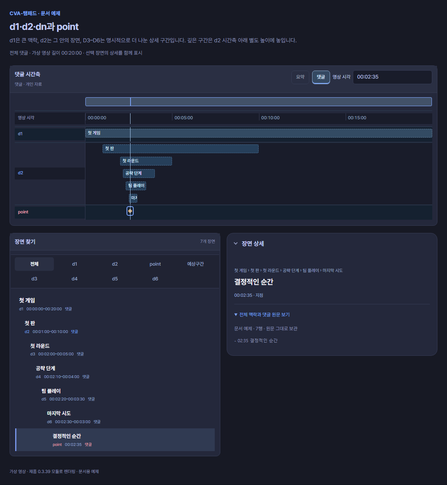

# CVA-탬패드 · CVA-TTaempad pro 0.4.0 시작하기

**CVA-탬패드 일반판과 CVA-TTaempad pro 0.4.0**의 사용 안내입니다. 두 제품은 다시보기의 장면·댓글·합방 탐색을 공유하며, 아래처럼 편집 방식이 다릅니다. 이 문서의 0.4.0 기준과 Chrome Web Store의 실제 심사·공개 상태는 별도로 확인합니다.

## 일반판과 Pro 고르기

| 하고 싶은 일 | 일반판 · CVA-탬패드 | Pro · CVA-TTaempad pro |
|---|---|---|
| 장면 찾기·다른 시점 비교 | 댓글·공개 요약·시간축과 합방 다시보기에서 장면 찾기 | 같은 원본 탐색과 비교에서 정밀 편집으로 이어가기 |
| 편집 방식 | 출처·시작·끝을 정한 컷을 담고 순서·길이 조절 | 시퀀스·트랙·클립으로 구성한 타임라인에서 위치·길이·효과 편집 |
| 저장·YouTube 전송 | 담은 컷을 MP4로 저장하거나 YouTube에 전달 | 현재 편집을 Export·Quick Export로 저장하거나 YouTube에 전달 |
| 작업 보관·공유 | 시간표·합방·컷 작업을 파일·링크로 공유 | 자동 저장과 수동 저장, Pro 전체 편집 공유. 로컬 영상·음원은 별도 재연결 |
| 먼저 읽을 곳 | [컷 수집과 저장](cuts.md) | [Pro 편집·자동 저장·내보내기](#pro-편집-시작) · [Pro 편집 공유](sharing.md#pro-전체-편집-보내기) |

필요한 제품을 각각 설치합니다. Pro의 시퀀스·트랙·효과 편집과 전체 편집 공유는 일반판의 컷 작업과 구분합니다. [현재 지원 범위와 확인 한계](limits.md)를 함께 확인하세요.

## 일반판 Chrome 설치

[일반판 Chrome Web Store 페이지 열기](https://chromewebstore.google.com/detail/cva-%ED%83%AC%ED%8C%A8%EB%93%9C/ajokeikoipagcdnpdkkbamidkjgeghon?hl=ko)

1. Store에서 제품명이 **CVA-탬패드**인지, 표시된 버전이 무엇인지 확인합니다.
2. 공개된 설치 항목의 **Chrome에 추가**로 설치하고, Chrome의 확장 목록에서 일반판을 찾습니다.
3. 접근할 수 있는 치지직 다시보기 페이지를 열고 **CVA-탬패드** 확장 버튼을 누릅니다.
4. 시간표나 장면을 불러와 컷을 담습니다. 저장·전송은 [컷 작업](cuts.md)에서 이어갑니다.

## Pro Chrome 설치

[Pro Chrome Web Store 페이지 열기](https://chromewebstore.google.com/detail/emkepdnkieiaadkciifenmhlkpiamhmm?hl=ko)

1. Store에서 제품명이 **CVA-TTaempad pro**인지, 표시된 버전이 무엇인지 확인합니다.
2. 공개된 설치 항목의 **Chrome에 추가**로 설치하고, Chrome의 확장 목록에서 Pro를 찾습니다.
3. 접근할 수 있는 치지직 다시보기 페이지를 열고 **CVA-TTaempad pro** 확장 버튼을 누릅니다.
4. Pro 작업실의 현재 프로젝트·시퀀스를 확인하고 [Pro 편집 시작](#pro-편집-시작)으로 이어갑니다.

**Store 배포 상태:** 두 제품의 0.4.0 심사·공개 완료는 이 가이드 작성 시점에 확인되지 않았습니다. 일반판은 기존 공개 버전이 표시되거나 Pro 페이지는 아직 열리지 않을 수 있습니다. Store의 실제 버전을 확인하고, 공개 전에 전달받은 개발 패키지는 아래 방법으로 구분해 설치하세요.

## 전달받은 Chrome 개발 패키지 설치

일반판과 Pro의 ZIP은 서로 다른 설치 파일입니다. 배포자가 제공한 해당 제품의 0.4.0 ZIP을 사용합니다.

1. 일반판 ZIP과 Pro ZIP을 서로 다른 폴더에 각각 풉니다. ZIP 안의 **manifest.json**이 있는 최상위 폴더가 설치 대상입니다.
2. Chrome 주소창에서 `chrome://extensions`를 열고 **개발자 모드**를 켭니다.
3. **압축해제된 확장 프로그램을 로드합니다**를 눌러 사용할 제품의 폴더를 고릅니다. 두 제품을 쓸 때는 이 단계를 제품별로 진행합니다.
4. 확장 목록에서 일반판 **CVA-탬패드**와 **CVA-TTaempad pro**, 각각의 버전 **0.4.0**을 확인합니다.
5. 치지직 다시보기에서 사용할 제품의 확장 버튼을 누릅니다. 두 제품을 설치한 경우 이름을 확인해 원하는 작업실을 엽니다.

기존 개발 설치를 업데이트할 때는 진행 중인 출력이 끝난 뒤 작업을 저장하고 작업실을 닫습니다. 배포자가 안내한 같은 설치 폴더의 파일을 갱신한 후 Chrome 확장 목록의 해당 제품 **새로고침**을 누르고 다시보기 페이지를 다시 엽니다. 개발 설치와 Store 설치는 식별자·저장 영역이 다를 수 있으므로, Store로 옮기기 전 작업 파일이나 공유 JSON을 따로 보관하세요. 설치만으로 기존 작업이 다른 제품이나 다른 설치에 자동 이전되지는 않습니다.

## Pro 편집 시작

Pro는 시퀀스·트랙·클립을 다루는 편집 작업실입니다. 원본에서 사용할 구간을 정한 뒤 현재 시퀀스의 타임라인에서 클립 위치·길이와 필요한 효과를 편집합니다. 로컬 영상·음원을 사용한 편집은 해당 파일을 직접 연결해야 합니다.

상단 **자동 저장 (10초)**은 기본으로 켜져 있습니다. 끄면 주기 저장을 멈추며 수동 저장과 작업실을 닫을 때의 저장은 유지합니다. [자동 저장과 출력](cuts.md#pro-자동-저장)을 확인하세요.

파일이나 YouTube로 보낼 때는 현재 시퀀스·출력 범위를 확인하고 **Export** 또는 **Quick Export**를 엽니다. [Pro의 Export·Quick Export 안내](cuts.md#편집자용-export-quick-export의-studio-연결)에서 파일 저장, Google 계정 연결과 Studio 탭 전달을 구분합니다. 두 제품 모두 영상의 기본 공개 범위는 **비공개**입니다.

편집을 다른 사람에게 보내려면 [Pro 전체 편집 공유](sharing.md#pro-전체-편집-보내기)를 사용합니다. 받는 사람도 Pro가 필요하며, 로컬 영상·음원 파일은 공유에 포함되지 않습니다. 받은 편집은 원래 다시보기 프로젝트를 덮어쓰지 않는 별도 공유 사본으로 열립니다.

긴 방송이 여러 다시보기로 나뉘었을 때 각 출처의 필요한 구간을 원하는 순서로 담고, 원본이 지원하는1080p·60fps를 유지해 연결된 Studio 탭으로 보낼 수 있습니다. 완성 MP4를 먼저 다운로드하고 파일 선택창에서 다시 고르는 단계는 없습니다. 12시간·실제 크기 한도 이내의 결과는 한 편이 기본이며, 필요한 경우 이유·경계를 안내하고 순차 업로드합니다. 브라우저 저장공간 추정치 때문에 임의로 나누지 않습니다. [컷 수집·순서·Studio 전달](cuts.md)을 확인하세요.

기존 댓글·참가자·시간축 설명과 합성 이미지는0.3.39 기반 기능을 유지합니다. 컷 저장·전송과 Pro 편집은 이 안내의 0.4.0 기준을 따릅니다.

```text
00:00 방송 시작
02:35 오늘 할 게임 이야기
08:12 다시 보고 싶은 순간
```

**이 기본 목록에서 한 줄은 하나의 이동 지점**입니다. `02:35`는 영상이 시작한 뒤 2분 35초입니다. 방송 날짜나 실제 시계의 시각이 아닙니다.

## 가장 짧은 사용 순서

1. 작업실에서 시간표 댓글을 선택하거나 평문·지원 파일을 가져옵니다.
2. 미리보기에서 시각, 주제·장면·순간, 원문과 확인 안내를 살펴봅니다.
3. 확인한 자료를 **시간축에 불러오기**로 채택합니다.

파일 선택이나 미리보기만으로 기존 자료를 덮어쓰지 않습니다.

## 이어서 사용할 댓글·시간표 기능

- **기호 없는 제목과 판 목록:** 시간 없는 짧은 제목이나 괄호 명단 뒤에 두 판 이상이 있으면 큰 주제 d1과 판 d2로 미리볼 수 있습니다. 제목은 첫 실제 판 시각에 연결합니다.
- **명단을 시작 앞뒤에:** 합방·내전 시작 바로 앞이나 뒤의 명단도 검색 후보로 읽습니다. 빈 줄은 건너뛰지만 설명·별도 목록·다른 댓글을 넘어 붙이지 않습니다.
- **팀 이름과 VS 표기:** 합방 문맥의 `VS`, `V.S.`, `versus` 등을 읽으며 공백이 든 이름과 원문을 유지합니다. 갈드컵·비교 이름을 참석자로 추측하지 않습니다.
- **중복 시각과 불확실한 끝:** 같은 시각의 판도 버리지 않고 확인이 필요한 point로 보존합니다. 명단의 소속이나 종료가 모호하면 조회 기간을 만들어 채우지 않습니다.

이 구조는 **잠정 추론**입니다. 미리보기에서 역할·구간·이름을 확인한 뒤 **시간축에 불러오기**를 누르세요. 명시 제목·태그·범위와 기존 강조 시각·괄호·번호·콜론 표기는 계속 읽습니다. 합방 멤버의 처음 12명·더보기, 분할 다시보기와 시각 보정도 [인물과 합방](people.md)에서 이어 확인할 수 있습니다.

[지원 형태 요약](formats.md) → [기존 댓글의 실제 예시](existing.md#기호-없는-제목과-판-목록) → [후보 이름과 조회 경계](people.md#합방-시작-앞뒤의-명단과-팀-표기)

## 시간축에서는 이렇게 보입니다

아래는 **0.3.39의 실제 제품 모듈에 가상 시간표를 넣어 만든 합성 예시**입니다. 같은 시간축에서 큰 주제, 하위 장면과 다시 볼 순간을 살펴봅니다. 실제 방송 내용·참여 명단이나 영상 재생을 확인한 화면은 아닙니다.



- **d1 · d2:** 큰 주제와 그 안의 장면을 구간 막대로 보여줍니다.
- **point:** 다시 보고 싶은 순간을 표식으로 보여줍니다. 별은 작성자가 강조한 지점입니다.
- **같은 세로선:** 각 행과 영상에서 현재 보고 있는 시점을 함께 확인합니다.
- **자료 표시:** 필요한 행을 골라 봅니다. 채팅량·시청자 클립은 해당 자료를 불러왔을 때 확인할 수 있습니다.

가이드의 시간표 PNG는 실제 제품 모듈로 만든 합성 예시입니다. 표시되는 행과 장면은 불러온 자료에 따라 달라집니다. 댓글을 가져온 뒤에는 원문과 해석 미리보기를 먼저 확인하세요.

d1·d2·dn, point와 예상구간의 뜻은 별도 목차인 [시간축 용어](timeline.md)에서 확인하세요. 주요 댓글 예제에는 입력을 해석한 시간축 그림을 함께 넣었습니다.

## 무엇부터 읽을까요?

- **공개 요약이나 로컬 파일을 쓴다면:** [요약과 JSON 가져오기](summary.md)에서 자료 종류와 적용 순서를 확인하세요. 호환 시간축 JSON·TXT는 ttaem.com에 게시하지 않고 가져올 수 있습니다.
- **d1·d2·point가 낯설다면:** [시간축 용어](timeline.md)에서 뜻과 화면의 행을 확인하세요.
- **처음 작성한다면:** [지원 형태 한눈에](formats.md)에서 짧은 예제를 골라 쓰세요.
- **이미 작성된 댓글이라면:** [기존 댓글 읽기](existing.md)에서 들여쓰기·목차·분리된 목록을 확인하세요.
- **시작과 끝을 지정한다면:** [구간과 강조](ranges.md)에서 순간과 범위를 구별하세요.
- **다른 시점을 찾는다면:** [인물과 합방](people.md)에서 이름·별칭으로 자동 검색하고 같은 시간대의 다시보기를 불러오는 방법을 확인하세요.

## 이 안내의 범위

두 제품의 설치·댓글 읽기·시간표 가져오기·컷 작업과 Pro 편집을 설명합니다. 모든 자연어를 자동으로 이해하지는 않습니다. [지원 형태](formats.md) · [문제 해결](limits.md)

화면과 댓글 예제를 함께 보며 확인할 수 있습니다. [작성 기준](reference.md)


시간표·합방·집계·컷을 함께 전달하려면 [링크로 공유하기](sharing.md)를 사용하세요. 댓글이 없는 다시보기에서도 공유 자료를 볼 수 있습니다.


## 컷으로 모아 저장하려면

[컷 작업과 MP4 저장](cuts.md)에서 시작·끝 조절, 출력 화질, 긴 영상 저장과 진행 상태를 확인하세요.
